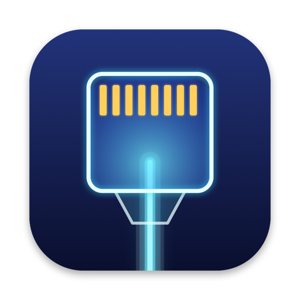

# ONT The Wire

App macOS per collegare il Mac **direttamente a un ONT FTTH** con un adattatore Ethernet e aprire una sessione **PPPoE**, con il tag **VLAN 802.1Q** applicato dal Mac (TIM: 835). Pensata per i tecnici in campo: niente router e niente switch di mezzo, la linea si verifica dal portatile.

<p align="center"></p>

## Cosa fa

- **PPPoE su VLAN taggata** generato dal Mac, su qualsiasi adattatore Ethernet USB o Thunderbolt (en5, en7, en8…). L'adattatore si sceglie all'avvio.
- **Riepilogo della sessione**: concentratore (AC-Name e MAC), Session ID, interfaccia PPP, indirizzo IP, gateway e DNS.
- **Connessione principale** (facoltativa): route predefinita e DNS passano dal PPPoE anche con il Wi-Fi attivo.
- **Test di velocità multi-flusso** in stile Ookla: ping e jitter, poi download e upload aggregati su 8, 16 o 32 connessioni parallele verso Cloudflare, Apple CDN e OVH, con la latenza sotto carico.
- **Log** dettagliato della negoziazione: PADI/PADO/PADR/PADS, LCP, CHAP/PAP, IPCP e codici di uscita di pppd tradotti in italiano.
- **Una sola autorizzazione** di amministratore per ogni avvio dell'app.
- **Nessun dato salvato**: a ogni avvio i campi sono vuoti. Credenziali e impostazioni non finiscono né su disco né nel Portachiavi.
- **Aggiornamento automatico**: a ogni avvio l'app controlla le release su GitHub e installa solo pacchetti con firma Ed25519 valida.

## Installazione

1. Scarica `ONT-The-Wire-<versione>.dmg` dalla pagina [Releases](https://github.com/Abi0ne/ONT-the-Wire/releases/latest).
2. Trascina **ONT The Wire** in **Applicazioni**.
3. Al primo avvio macOS blocca l'app, perché non è notarizzata. Autorizzala da **Impostazioni di Sistema › Privacy e sicurezza › Apri comunque**, oppure da Terminale:
   ```sh
   xattr -dr com.apple.quarantine "/Applications/ONT The Wire.app"
   ```

**Requisiti**:
- macOS 14 Sonoma o successivo;
- Mac con Apple Silicon;
- un account amministratore;
- un adattatore Ethernet.

## Uso in breve

1. Collega l'adattatore al Mac e un cavo dalla porta LAN dell'ONT all'adattatore.
2. Apri l'app e autorizzala con password o Touch ID.
3. Scegli l'adattatore e inserisci il VLAN ID (lascialo vuoto per una linea senza tag), poi username e password PPPoE.
4. Premi **Connetti**. A sessione attiva, dalla scheda **Riepilogo** puoi lanciare il test di velocità.

Istruzioni complete e soluzione dei problemi: **[Manuale d'uso](docs/MANUALE.md)**.

## Documentazione

| Documento | Contenuto |
| --- | --- |
| [docs/MANUALE.md](docs/MANUALE.md) | Manuale d'uso: installazione, connessione, test di velocità, log, errori |
| [docs/ARCHITETTURA.md](docs/ARCHITETTURA.md) | Perché non si usa il PPPoE di macOS, come sono fatti relay, broker e supervisore |
| [docs/SICUREZZA.md](docs/SICUREZZA.md) | Privilegi, gestione delle credenziali, firma degli aggiornamenti |
| [docs/BUILD.md](docs/BUILD.md) | Compilazione, test, pubblicazione di una release |
| [CHANGELOG.md](CHANGELOG.md) | Novità di ogni versione |

## Compilazione

Bastano i Command Line Tools (Swift 6), Xcode non serve.

```sh
./scripts/build-app.sh            # crea "build/ONT The Wire.app"
open "build/ONT The Wire.app"
./scripts/test.sh                 # test unitari
```

Dettagli in [docs/BUILD.md](docs/BUILD.md).
